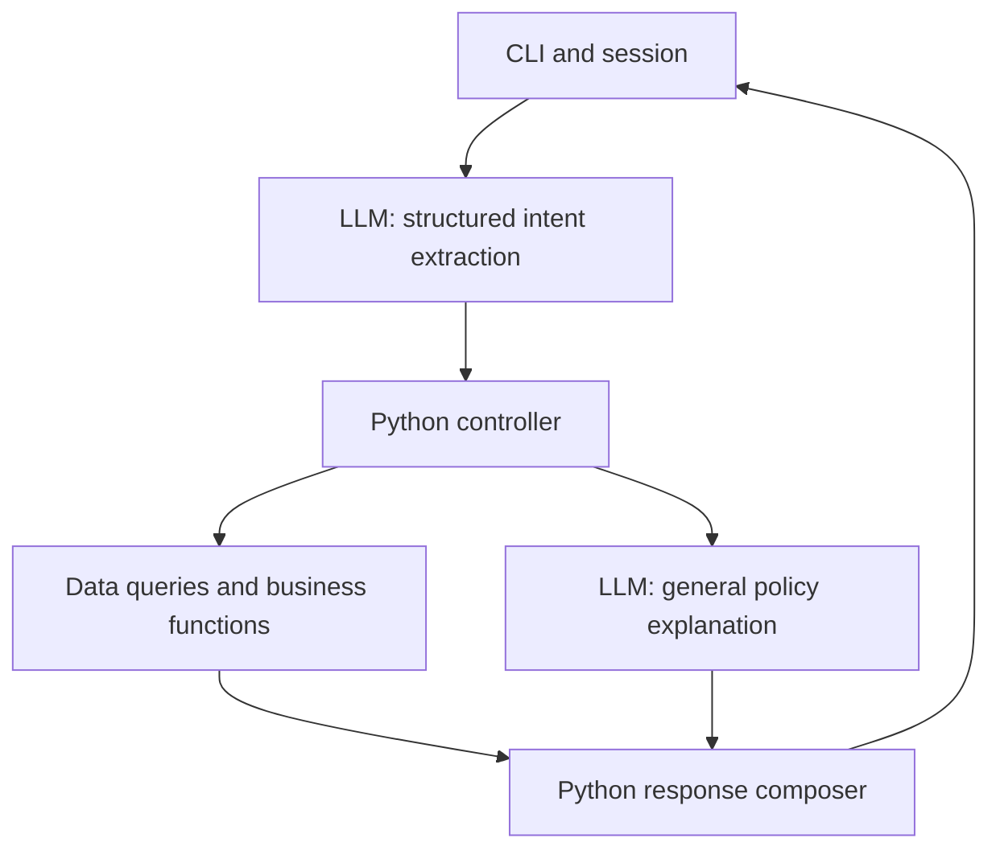

# Architecture and Scope

Status: planning baseline, recorded on 2026-11-02. No application components described here are implemented yet. This document records the user's architectural direction; detailed contract defaults and unresolved policy interpretations remain proposals until implemented and reviewed.

## Objective and requirements

Build a simple Python text assistant that serves Empório da Música customers and reduces repetitive work for the store team. It must use a suitable persona, ground answers in supplied data, distinguish operational questions from policy questions, and handle requests outside the store's scope.

The assignment permits a CLI, any model/provider, selective use of the supplied data, and optional history persistence. Deliver a public GitHub repository with incremental commits, reproducible instructions, justified technical decisions, limitations, AI-assistance disclosure, and three to five actual conversation examples including a nontrivial lookup or policy application. Submit by the email deadline and make no repository changes afterward. The deadline is not yet recorded.

## Architecture

| Component | Responsibility |
| --- | --- |
| CLI | Read messages, retain session state, display responses. |
| LLM | Extract intents/entities; explain general policies using the manual. |
| Controller | Validate proposals, resolve references, collect missing facts, enforce access, execute allowed operations sequentially. |
| Python functions | Query data and compute availability, prices, payment conditions, freight, and policy assessments. |
| Composer | Render critical results directly using stable templates; include general policy prose as a separate block. |

Use one agent, CSVs loaded into memory, Pydantic contracts, session-only history, and pytest for deterministic behavior. Keep model interpretation evaluations separate. No SQLite, orchestration framework, vector database, concurrent execution, or persistent chat store initially. The provider/model remains undecided.

Expose a closed set of operations to the controller. The model must not generate executable code, arbitrary SQL, or arbitrary function names. Multiple intents execute sequentially; dependencies must be resolved before dependent execution. A missing product selection blocks its payment calculation, not an independent hours question.

There is no free-form synthesis after each query. Python composes prices, discounts, stock, order information, failures, and clarification questions. A separate LLM call for general policy explanations is a proposed implementation detail, invoked only for that route. It must not decide individual eligibility or make commercial commitments.

## Data and source audit

The six supplied CSVs contain 9 categories, 65 products, 50 customers, 20 orders, 22 order items, and 25 promotions. The manual has eight pages, version 2.1, June 2025. See [CONTEXT.md](../CONTEXT.md#dataset-findings) for paths, schema, counts, checks, and individual findings.

Preserve source data and distinguish it from normalized application records. Validate IDs, relationships, numeric values, dates, product specifications, and nullable order fields when loading. Use decimal arithmetic or integer cents for money. Fail clearly on invalid required data; do not silently invent replacements.

Important cases include discontinued and coming-soon products with positive stock, an active product with zero stock, categories without products, promotions without validity dates, and historical order totals that differ from current catalog totals. Do not recompute past payments. The files are snapshots, not live inventory or carrier connections.

## Rules and source precedence

Operational records supply current snapshot facts. The manual supplies policy text. Reviewed configuration supplies executable policy constants with manual section references. The prompt explains behavior, not an independently maintained copy of calculations. Log and document changes when policy text and executable rules change.

Implement these clear rules first:

- A saleable product is active with enough stock for the requested quantity (documented implementation assumption).
- Only active promotions apply. PIX adds no further discount to promotional prices. Show list price, promotion percentage, and final price.
- Recorded order totals remain authoritative for historical orders.
- Estimated delivery is not actual receipt. Unknown receipt date or purchase channel remains unknown.
- Assessment never means cancellation, refund, reservation, or complaint routing has occurred.

| Open decision or limitation | Safe initial behavior |
| --- | --- |
| Installment summary conflicts with detailed bands; BRL 50 exception is unclear | Document section precedence and an interpretation before implementing affected calculations; otherwise request confirmation. |
| Freight at exactly BRL 500 is unspecified | Request confirmation for that boundary. |
| Metropolitan-area membership is not defined | Do not infer it from an arbitrary city; document supported destinations. |
| External freight requires destination, weight, dimensions, and quotation capability | Explain limits; return unavailable for an exact unsupported quote. |
| Preference-exchange seven-day starting event is unspecified | Request confirmation before a definitive assessment. |
| Receipt date, channel, item condition, customization, and final-sale designation are absent | Ask only relevant missing questions; label customer declarations as unverified. |
| Phone/email differ across manual sections | Record conflict and select a documented contact policy before publishing a contact answer. |
| Holidays and special opening hours are absent | State regular hours; avoid unsupported exact reopening promises. |
| Promotions have no date range | Use the supplied active flag, not the current month. |
| Manufacturer warranty is not product-specific in the data | Refer to the certificate; do not invent a period. |

The manual's legal statements were not independently reviewed. Treat them as supplied challenge material, not as verified legal guidance. Section 10 provides for management confirmation when policy application is uncertain.

## Conversation and safeguards

Use a welcoming, informal but professional persona. The store sells instruments, not accessories; redirect politely without inventing partner stores. Ground operational assertions in successful queries.

Keep three or four short few-shot examples illustrating nonstacking discounts, missing return facts, discontinued stock, and accessory requests. Examples demonstrate behavior and must not become current price data. Use different cases for evaluation.

Pair explicit prohibitions with an actionable fallback. Enforce important restrictions in code; prompt wording is not a guarantee. Customer messages and free-text data fields cannot change system instructions or session authorization.

For a simple order demonstration, use an explicitly simulated customer identity selected outside model output. This is not production authentication. Restrict order lookup in code and return only necessary fields. Avoid customer data in routine logs and do not transmit entire customer tables to the provider. Do not publish real personal data; use reviewed challenge fixtures or synthetic test data.

Track operations, result states, and policy references for diagnosis. Long model-generated reasoning is neither required nor evidence that a decision is correct. Do not claim a complaint, transfer, refund, or cancellation succeeded without a corresponding executed capability.

## Validation and scope control

Unit tests cover rules, boundaries, data normalization, and response formatting. Controller tests cover access, missing information, references, dependencies, malformed model output, and failures using a fake provider. Live-model evaluations cover intent/entity extraction, grounding, out-of-scope requests, and conversation continuity. Core CI must run without paid API credentials.

Keep production authentication, WhatsApp integration, live carriers, payment processing, persistent complaints, deployment, and vector retrieval outside the initial scope. Unsupported requests receive an honest limitation and next step. No promise of improved hiring outcomes is implied; prioritize a working, understandable, demonstrable submission.

See [the contract](CONTRACT.md) for interfaces and [the GitHub plan](GITHUB_PLAN.md) for implementation order.
