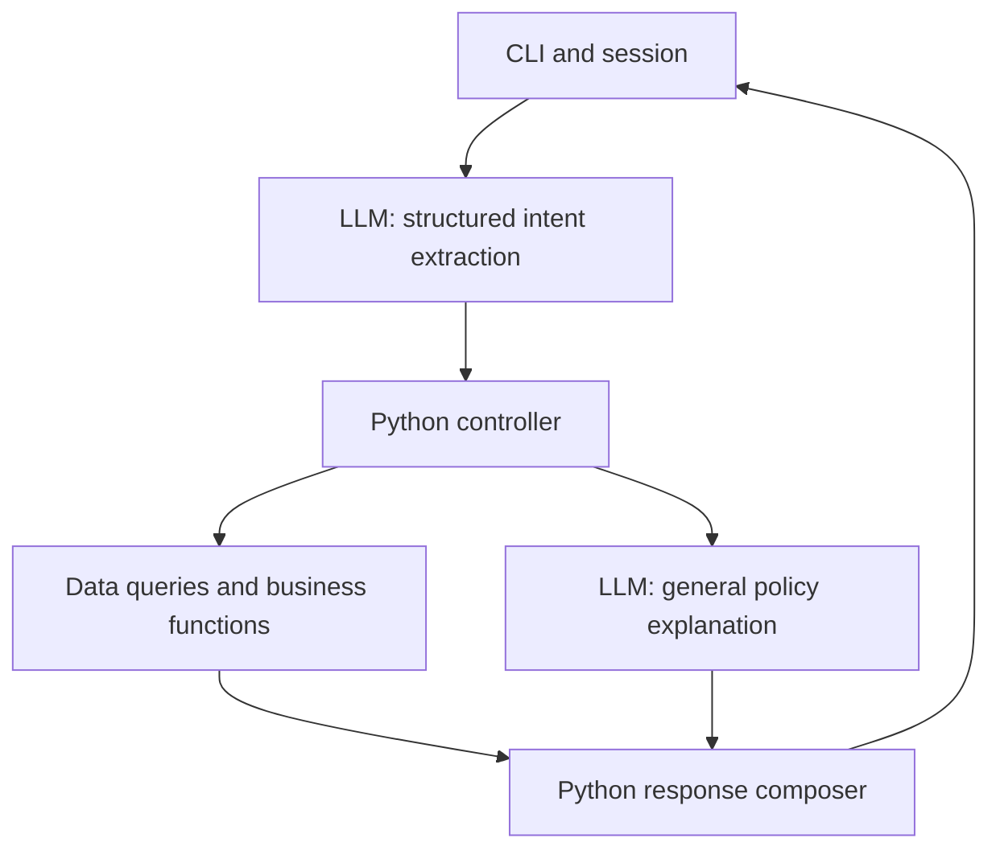

# Architecture

This document describes the implemented system: its structure, policy decisions, feature behavior, and contracts. See the [README](../README.md) to run it and the [evaluation report](EVALUATION.md) for live results.

## Overview



| Component | Responsibility |
| --- | --- |
| CLI | Read messages, retain session state, display responses. |
| LLM | Extract intents/entities; explain general policies using the manual. |
| Controller | Validate proposals, resolve references, collect missing facts, enforce access, execute allowed operations sequentially. |
| Python functions | Query data and compute availability, prices, payment conditions, freight, and policy assessments. |
| Composer | Render critical results directly using stable templates; include general policy prose as a separate block. |

The system uses one agent, CSVs loaded into memory, Pydantic contracts, session-only history, and pytest for deterministic behavior, with model evaluations kept separate. There is no SQLite, orchestration framework, vector database, concurrent execution, or persistent chat store. The provider is local Ollama with a configurable model, `qwen2.5:3b` by default. Small-model limitations and live results are in [the evaluation report](EVALUATION.md). Provider-neutral interfaces and extraction validation live in `providers/base.py` and `providers/extraction.py`; the offline adapter is isolated in `providers/demo.py`. The official extraction prompt is `providers/prompts/extraction.md`, loaded after the full manual context. It classifies general policy questions without emitting free-form answers. General explanations use a separate call with `providers/prompts/policy.md`, validated in `providers/policy.py`. The CLI constructs adapters and owns terminal interaction, while the controller imports only the neutral interface and extraction function. Package initializers do not load concrete adapters or the CSV loader.

Expose a closed set of operations to the controller. The model must not generate executable code, arbitrary SQL, or arbitrary function names. Multiple intents execute sequentially; dependencies must be resolved before dependent execution. A missing product selection blocks its payment calculation, not an independent hours question.

For warranty-only general explanations, Python now renders a reviewed summary of manual §§8.1–8.3 after validation: the model selects the topic/sections but does not rewrite the warranty facts. Other general explanations retain the validated prose route, with its documented semantic limitations.

There is no free-form synthesis after each query. Python composes prices, discounts, stock, order information, failures, and clarification questions. A separate LLM call handles general policy explanations only. It does not decide individual eligibility or make commercial commitments.

## Data and source audit

The six supplied CSVs contain 9 categories, 65 products, 50 customers, 20 orders, 22 order items, and 25 promotions. The manual has eight pages, version 2.1, June 2025.

The loader uses standard-library CSV parsing in `data/loader.py` and typed dataclass records in `data/records.py`; Pydantic intent/result contracts are implemented separately in `contracts/`. It accepts an explicit source directory and returns all six tables with in-memory indexes only after validation succeeds. Original files remain external and unchanged. A derived demonstration snapshot in `data/demo/` replaces customer details, order notes, and tracking codes with synthetic values; it is the default for the validation command. Tests cover small synthetic fixtures and the bundled demonstration.

Preserve source data and distinguish it from normalized application records. Validate IDs, relationships, numeric values, dates, product specifications, and nullable order fields when loading. Use decimal arithmetic or integer cents for money. Fail clearly on invalid required data; do not silently invent replacements.

Important cases include discontinued and coming-soon products with positive stock, an active product with zero stock, categories without products, promotions without validity dates, and historical order totals that differ from current catalog totals. Do not recompute past payments. The files are snapshots, not live inventory or carrier connections.

### Dataset findings

| Table | Rows | Fields |
| --- | ---: | --- |
| categories | 9 | category_id, name, description |
| products | 65 | product_id, price_brl, name, category_id, description, stock_quantity, status, specs, created_at |
| customers | 50 | customer_id, name, phone, email, city |
| orders | 20 | order_id, customer_id, order_date, status, total_brl, payment_method, tracking_code, estimated_delivery, notes |
| order_items | 22 | order_id, quantity, product_id |
| promotions | 25 | promotion_id, product_id, discount_percent, description, is_active |

Checks found no duplicate primary IDs, duplicate order/product item pairs, or orphan references across the table relationships. Product specifications are valid JSON; product creation dates parsed and prices/stock passed nonnegative checks. Empty fields occur in orders: 12 missing tracking codes, 12 missing delivery estimates, and 16 empty notes. This is a targeted audit, not proof of complete data correctness.

Important cases:

- Product statuses: 62 `active`, two `discontinued`, one `coming_soon`. Product 96 is active with zero stock; 113 is discontinued with zero stock; 136 is discontinued with 13 units; 130 is coming soon with two units. Proposed availability rule: active status AND positive stock. This is an implementation interpretation, not an additional CSV field.
- Only six categories have products: 35 violões, 15 ukuleles, five guitars, four basses, three drums/percussion products, and three keyboards/pianos. Categories 6–8 have no products in this snapshot. Category descriptions do not prove that an item is sold or available.
- Four promotions are active: product 127 at 10%, 121 at 20%, 90 at 18%, and 94 at 8%. There are no multiple active promotions per product in this snapshot and no promotion start/end dates. Use `is_active`; do not activate campaigns based on the current month.
- Order statuses: seven delivered, one shipped, four confirmed, four pending, four cancelled. Dates range from October 2025 to March 2026. These are historical snapshots, not live carrier or inventory integrations.
- Orders 3 and 20 have recorded totals of BRL 3,450 and BRL 1,400, versus current item-price sums of BRL 3,498 and BRL 1,488. There are no historical unit prices explaining the difference. Preserve `orders.total_brl`; do not overwrite it using today's catalog or discounts.
- Orders have neither actual receipt date nor purchase channel. `estimated_delivery` must never be used as proof of receipt. Other return conditions, such as product condition or customization, are not structured fields in these tables.
- Customer city alone does not establish delivery address or eligibility for metropolitan delivery. Outside-region freight requires information/integrations absent from the supplied tables.

## Rules and source precedence

Operational records supply current snapshot facts. The manual supplies policy text. Reviewed configuration supplies executable policy constants with manual section references. The prompt explains behavior, not an independently maintained copy of calculations. Log and document changes when policy text and executable rules change.

These rules are clear in the sources:

- A saleable product is active with enough stock for the requested quantity (documented implementation assumption).
- Only active promotions apply. PIX adds no further discount to promotional prices. Show list price, promotion percentage, and final price.
- Recorded order totals remain authoritative for historical orders.
- Estimated delivery is not actual receipt. Unknown receipt date or purchase channel remains unknown.
- Assessment never means cancellation, refund, reservation, or complaint routing has occurred.

### Policy decisions

Recorded on 2026-11-02. These are prototype decisions, not changes to store policy. References below were checked against the text of all eight pages of the supplied `políticas_da_loja.pdf`, version 2.1, June 2025, on 2026-11-02. The original remains outside the repository. The choices below distinguish explicit rules from prototype assumptions. This verifies the supplied source, not its legal correctness.

| Case and source | Chosen behavior | Rationale and limitation |
| --- | --- | --- |
| Credit installment summary versus detailed bands (§§3, 3.1) | Prefer §3.1 for explicit requests of 4–6 installments (BRL 80 minimum each) and 7–12 (BRL 100 minimum each). Requests for 2–3 installments are quoted when each installment is at least BRL 100, which satisfies every reading; below that they require confirmation because the BRL 50 exception is unclear. | The detailed section is more specific than the general BRL 100 summary. This is a documented interpretation; the original wording confirms the conflicting summary and detailed bands. A general answer must not promise every purchase can use 12 installments. |
| Combined payment (§3) | Recognize the request, state the BRL 2,000 threshold, say when the order is below it, and return `requires_confirmation`; do not calculate a split or commit payment terms. | The manual allows combinations above BRL 2,000, but allocation and discount interaction are not defined. The threshold is compared with the list or promotional total; exactly BRL 2,000 keeps the general message. |
| Freight exactly BRL 500 (§5) | Return `requires_confirmation` for an otherwise eligible local quote at exactly BRL 500. | Neither the above nor below rule covers equality; do not silently choose free freight or BRL 35. |
| Local delivery region (§5) | Initially support only a customer-declared destination city of Campo Grande/MS. Other cities require confirmation of region eligibility. Ask for destination when absent; do not substitute a customer's recorded city for the delivery address. | Including the store's own city is an explicit prototype assumption. No metropolitan municipality list or postal-code mapping is supplied. Normalize case/accents only; do not infer geography from a postal code. |
| Freight subtotal (§§3, 5, 6) | Compare BRL 500 against the sum of supported item totals after applicable discounts, before freight. Require products, quantities, and payment conditions sufficient to calculate that subtotal. | This is an implementation assumption because the manual does not define the comparison basis. Missing basket quantities are not defaulted to one, except that a direct freight request with no quantity word and no earlier quote is quoted for one stated unit. For the supported city, below BRL 500 costs BRL 35; above is free. |
| External or special freight (§5) | Exact outside-region/carrier quotations are `unavailable`. A city whose region membership is unknown first requires confirmation. | There is no carrier integration, product weight/dimension coverage, or supported quotation capability. Collecting a postal code alone cannot make an exact quote possible. Manual transit ranges may be described as general estimates, never a promised arrival date. |
| Preference-exchange starting event (§4.3) | Individual preference assessments return `requires_confirmation` for the start of the seven-day period, even if purchase and receipt dates are known. | Selecting purchase or receipt would invent a policy. General explanations can state the seven-day wording and the unresolved starting event. Stock and condition remain relevant but cannot resolve this ambiguity. |
| Conflicting phone/email (cover/company table, §7) | Publish neither conflicting phone nor email as the authoritative contact. A contact request returns `requires_confirmation` and explains that the supplied manual conflicts. | No source establishes precedence. Do not invent a channel, claim a transfer, or ask the customer to select the official contact. A reviewed source correction is needed. |
| Simulated customer identity (§9; architecture safeguard) | The CLI startup option `--customer-id` selects a known fixture customer outside the model and conversation. Validate it against loaded records; an unknown supplied identity fails startup. With no identity, catalog/policy routes remain usable but order access is `unauthorized`. Identity stays fixed until a new session. | This demonstrates access scoping, not authentication. A message, email, order number, or model field cannot establish identity. Use reviewed challenge data or synthetic records, minimize exposed fields, and render foreign/nonexistent orders consistently. |

### Clock and calendar

Use the IANA store timezone `America/Campo_Grande`, based on the supplied store location, independently of the developer's timezone. Inject a timezone-aware clock into date-dependent application logic; convert its instant to the store timezone before deriving today's date. Tests provide a fixed instant, including cases on either side of local midnight. Reject naive clock values rather than assigning an implicit timezone. `tzdata` supplies timezone data on every supported platform.

Resolve relative customer dates against that clock only when their meaning is unambiguous. Otherwise ask for an explicit date. Reject future dates asserted as past receipt; an order delivery estimate never establishes receipt. Preserve customer-declared dates separately from verified records. For a known starting date, use calendar-date differences, with elapsed day zero on that date and the stated last day included. This day-count convention is a prototype assumption, not legal advice; it does not resolve the missing start event for preference exchanges.

Regular hours remain Monday–Friday 09:00–18:00 and Saturday 09:00–13:00, closed Sundays/holidays (§2). No holiday calendar, special hours, dispatch calendar, or business-hour counting convention is supplied. State regular hours and any manual business-day ranges with their limitations; do not calculate exact arrival, refund, or complaint-response deadlines. Outside regular hours, the CLI states when the team returns by the regular schedule (§7.1), noting that holidays are not known. The current date alone cannot prove the store is open.

### Supported operation boundary

This table uses the statuses defined under [Operation results](#operation-results).

| Classification | Cases |
| --- | --- |
| Supported | Snapshot catalog queries, active/stock availability, nonstacking promotion/PIX calculations, historical order lookup scoped to the simulated session, supported installment bands and Campo Grande freight, and general explanations grounded in the manual. Withdrawal/defect assessments use relevant known or explicitly declared facts and assess conditions only. |
| `needs_information` | Missing or ambiguous product/order selection, destination, basket quantity, payment conditions, purchase channel, actual receipt, or relevant product-condition facts. Ask only for facts needed by the pending operation. |
| `requires_confirmation` | Ambiguous installment band, combined payment, exact BRL 500 local freight, unknown metropolitan eligibility, preference-exchange start event, conflicting contacts, or another policy judgment reserved for management (§10). State the need for confirmation without claiming it was requested from a person. |
| `unavailable` | Exact external freight, live inventory/carrier updates, payment execution, refund, cancellation, reservation, complaint registration, human transfer, and production authentication. Acknowledging or assessing a request does not perform it. |
| `unauthorized` | Order access without an established simulated identity. For an established identity, foreign and nonexistent order references share a nonrevealing external response. |

Product-specific warranty periods are unknown (§8): state the manual's general range and refer to the product certificate. Active promotion flags govern the snapshot (§6), not today's month. Promotions do not imply final-sale exclusions (§4.4). Negative availability or assessment is a successful business result, not a technical failure. Errors must not produce fallback prices or invented policy facts.

The manual's legal statements were not independently reviewed. Treat them as supplied challenge material, not as verified legal guidance. Section 10 provides for management confirmation when policy application is uncertain.

## Conversation and safeguards

Use a welcoming, informal but professional persona. The store sells instruments, not accessories; redirect politely without inventing partner stores. Ground operational assertions in successful queries.

Keep three or four short few-shot examples illustrating nonstacking discounts, missing return facts, discontinued stock, and accessory requests. Examples demonstrate behavior and must not become current price data. Use different cases for evaluation.

Pair explicit prohibitions with an actionable fallback. Enforce important restrictions in code; prompt wording is not a guarantee. Customer messages and free-text data fields cannot change system instructions or session authorization.

For a simple order demonstration, use an explicitly simulated customer identity selected outside model output. This is not production authentication. Restrict order lookup in code and return only necessary fields. Avoid customer data in routine logs and do not transmit entire customer tables to the provider. Do not publish real personal data; use reviewed challenge fixtures or synthetic test data.

Track operations, result states, and policy references for diagnosis. Long model-generated reasoning is neither required nor evidence that a decision is correct. Do not claim a complaint, transfer, refund, or cancellation succeeded without a corresponding executed capability.

## Validation and scope control

Unit tests cover rules, boundaries, data normalization, and response formatting. Controller tests cover access, missing information, references, dependencies, malformed model output, and failures using a fake provider. Live-model evaluations cover intent/entity extraction, grounding, out-of-scope requests, and conversation continuity. Core CI must run without paid API credentials.

Production authentication, WhatsApp integration, live carriers, payment processing, persistent complaints, deployment, and vector retrieval are outside the scope. Unsupported requests receive an honest limitation and next step.

## Contracts

### Modules and limits

| Module | Implemented responsibility |
| --- | --- |
| `contracts/common.py` | Strict, extra-forbidden, frozen model configuration and bounded scalar types. |
| `contracts/intents.py` | Nine intent variants, complete-turn and clarification schemas, and sanitized JSON parsing. |
| `contracts/dates.py` | Injected aware clock, store date, and receipt-date resolution. |
| `contracts/results.py` | Discriminated operation results with operation-specific data and status consistency. |
| `contracts/session.py` | Startup identity validation, bounded session history, provenance, and pending-update allowlists. |
| `providers/base.py` | Provider protocol, minimal request context, and provider errors. |
| `providers/extraction.py` | Validated extraction with one schema-repair attempt; no operation dispatch. |
| `providers/ollama.py` | Local Ollama structured extraction, bounded transport, and reviewed manual context. |
| `providers/demo.py` | Offline command-based provider implementing the extraction protocol. |
| `controller.py` | Sequential catalog execution, actual-record references, scoped pending updates, and sanitized failure handling. |
| `composer.py` | Portuguese catalog prices, availability, limitations, and focused clarification templates. |
| `cli.py` | Bounded offline command-based demonstration using a fake provider. |

The implemented limits are five intents, 20 history messages, five pending operations, 4,000 characters per text field, and 32,000 UTF-8 bytes per provider response. Limits live in Python, not model output. Empty turns, unknown/extra fields (including nested fields), duplicate JSON keys, and malformed values are rejected. More than five intents raises `RequestTooBroadError`, which bypasses schema repair so the controller asks the customer to narrow the request. Other malformed outputs raise `ProposalError("Invalid model proposal")`, without echoing raw inputs. Do not log raw Pydantic `.errors()` payloads, which can contain input values despite sanitized string representations.

`received_at` accepts ISO dates or exactly `today`, `yesterday`, and `day_before_yesterday`; Python resolves these against the injected clock in `America/Campo_Grande`. Other relative/ambiguous expressions must be clarified rather than guessed. A receipt after the store's current date is rejected. The parsed value is a customer-declared date, not a verified receipt. `tzdata` is a runtime dependency to support Windows as well as platforms with a system timezone database. A naive clock is a configuration error, not a model repair opportunity.

### Intents

The LLM proposes intents and extracts explicitly supplied information. The controller resolves records, validates business conditions, determines session access, and executes allowed functions. Pydantic validates structure and types; it does not establish authorization or business correctness.

| Type | Allowed extracted fields | Execution boundary |
| --- | --- | --- |
| `product_search` | query, category, max_price_brl, available_only, quantity, payment_method, installments | Resolve category/name; query, compute conditions, then filter by the requested payment price. |
| `order_status` | order_id | Query only within the authorized session; ask if order selection is missing. |
| `payment_options` | product_reference, quantity, payment_method, installments | Resolve product and calculate supported conditions. |
| `shipping_quote` | product_reference, quantity, destination, payment_method, installments | Calculate only supported cases; require confirmation or report unavailable otherwise. |
| `return_assessment` | order_id, reason, purchase_channel, received_at, condition | Evaluate supported rules with explicit provenance for declared facts. |
| `policy_question` | topic, question | Explain general policy; no individual approval or computed quote. |
| `complaint` | description | Acknowledge and explain the available next step; no false registration/transfer claim. |
| `out_of_scope` | topic | Politely redirect to store scope. |
| `small_talk` | kind | Template greeting, thanks, or goodbye. |

Implemented enums: payment method `pix`, `debit`, `credit`, `boleto`, `combined`; return reason `withdrawal`, `defect`, `preference`; purchase channel `online`, `in_store`; small-talk kind `greeting`, `thanks`, `goodbye`. Unknown or unsupported enum values are rejected structurally, never coerced into the nearest supported value. The extraction boundary permits one repair, then reports a stable error; customer-facing clarification belongs to the controller. Combined payment requires confirmation.

`product_reference` is a discriminated object: `{"kind":"query","query":"..."}`, `{"kind":"selected"}`, or `{"kind":"ordinal","ordinal":2}` (one-based displayed position). The controller assigns product IDs after lookup. Destination contains nullable customer-declared city, two-letter uppercase state, and postal code (eight digits, with an optional hyphen); neither alone proves metropolitan eligibility. Condition contains nullable booleans for original packaging, signs of use, complete accessories/manuals, and reported customization/final-sale notice. Preserve uncertainty rather than defaulting missing booleans to false.

### Clarification and session state

Maintain only session-lifetime state: simulated/authorized customer identity, bounded conversation history, last displayed products, selected product/order, and pending operations with collected facts. Provenance distinguishes system records from customer declarations.

For "this one", use a unique selected product; multiple possible products require clarification. An ordinal selection must refer to the actual list displayed before the current turn. Search results and successful product quotes share a global numbering sequence in first-display order, at most 50 distinct records per turn (five intents of up to ten results); one search returns at most ten. A `selected` reference can depend on a unique successful lookup earlier in the same turn, but an ordinal cannot predict unseen search results. A correction replaces the corresponding declared fact and invalidates dependent calculations. Quoting products from the list seen last turn keeps that list, so later ordinals still refer to it; a list is replaced only when a new list is actually shown. A quote that names no product keeps the selected product; only a reference that fails to resolve clears it.

During a pending operation, accept a narrowly scoped structured update to its allowed missing fields, identified by a controller-issued pending ID. This is an alternative clarification payload, not permission to mutate session identity or arbitrary state. Specify its Pydantic schema alongside the intent schemas. The controller cancels all pending operations on `/cancelar`; a new complete turn replaces prior pending work. Exception: a new `payment_options` intent whose reference is `selected` or absent, while a pending quote exists for the currently selected resolved product, reuses that quote's declared quantity and payment method when the new intent leaves them null. The check uses the selection current at that point of the turn, so a search earlier in the same turn prevents inheritance; a payment method is not inherited when the new intent supplies installments. Small models often answer a clarification this way instead of with an update; a quote for a different product inherits nothing. The fact-reuse rules in the `shipping_quote` paragraph above extend this exception. Clarification updates preserve other pending operations and re-evaluate only the target. A resolved product ID remains pinned when collecting other fields; unresolved references require an explicit reference update, not an unrelated later selection. Completed-request corrections use a new turn. These are initial controller behavior choices; automatic resumption of other pending operations is not implemented.

Execute independent intents in source order. Resolve dependent values from actual results, never from a model-predicted result. If one operation needs clarification, suspend its dependents but allow independent operations to complete. No concurrency or general-purpose dependency graph is required.

### Return requirements

Return requirements: without a reason, only `reason` is requested. Withdrawal (§4.1) requires `purchase_channel`, `received_at`, and `condition`; an in-store purchase is immediately `conditions_not_met`. Defect (§4.2) requires `order_id`, because its 30-day window starts at the recorded `order_date`; order access follows the order-lookup rules (no identity is `unauthorized`, foreign and nonexistent orders are the same `not_found`). Preference (§4.3) requires `condition` and always reports its seven-day window as `requires_review`. An order is optional for withdrawal and preference; when supplied and accessible, a non-delivered status or a receipt before the order date requires review. A declared defect always requires store inspection. Exclusions (§4.4) count against exchanges when declared true and are `unknown` when absent; for withdrawal, declared exclusions require review because §4.4 does not state its effect on §4.1. Any unsatisfied condition yields `conditions_not_met`; otherwise any unknown or review item yields `requires_review`. Windows use the store-date difference from the injected clock, with day zero on the starting date and the last day included. Receipt dates accept `today`, `yesterday`, `day_before_yesterday`, ISO `YYYY-MM-DD`, and Brazilian `DD/MM/YYYY` (added after the live model copied that format literally); dates without a year are rejected. An order number supplied by the model is discarded unless typed in the current message outside money amounts and date expressions (`dia 5`, `05/11`, ISO dates, `5 de novembro`); a receipt date is discarded unless its day number is typed in the current message or `hoje`/`ontem`/`anteontem` is used. When the declared receipt precedes the recorded order date, the withdrawal window requires review. A clarification that answers extra return facts is merged as a new turn with the pending declarations while other pending operations are kept, and a new return turn reuses facts declared for a pending return only for the same or no reason and the same or no order. Known limitation: product-condition booleans and the purchase channel are customer declarations interpreted by the model and are not checked against the message text; a model error can attribute an undeclared condition to the customer. Model-interpretation evaluations, not deterministic tests, must cover this.

### Operation results

| Status | Meaning |
| --- | --- |
| `success` | Query or supported assessment completed. |
| `not_found` | No matching accessible record/result. |
| `needs_information` | Customer-supplied facts or a selection are missing. |
| `requires_confirmation` | Ambiguous policy or human decision blocks a commitment. |
| `unauthorized` | Session cannot access the operation/data. |
| `unavailable` | Required capability is not implemented or supported. |
| `error` | Technical execution failure. |

An out-of-stock lookup is `success` with an availability value in `data`. A negative assessment is also a business outcome, not a technical error. External order messages must not reveal whether another customer's order exists; render inaccessible and nonexistent references consistently where needed.

### Response composition

Render completed results first, then limitations, then one focused clarification (which may group closely related missing fields). When several operations are pending, the question names the first operation and states how many others are waiting. All operational numbers, stock, order facts, errors, and clarification questions are rendered in Python with Brazilian currency/date formatting. General policy prose is a separate block and cannot rewrite operational blocks. Do not display internal IDs/reason codes unnecessarily.

## Feature behavior

### Data loading

Required filenames are `desafio_tecnico_ai_eng - categories.csv`, `desafio_tecnico_ai_eng - products.csv`, `desafio_tecnico_ai_eng - customers.csv`, `desafio_tecnico_ai_eng - orders.csv`, `desafio_tecnico_ai_eng - order_items.csv`, and `desafio_tecnico_ai_eng - promotions.csv`. All must have their supplied header and UTF-8 encoding (an optional BOM is accepted). Column order may vary; missing, duplicate, or additional columns are rejected. Surrounding field whitespace is removed; blank required values and malformed records fail the whole load.

The command prints only table counts on success and exits with status 1 on data errors. The supplied snapshot produces 9 categories, 65 products, 50 customers, 20 orders, 22 order items, and 25 promotions. Counts are audit evidence, not hardcoded validation constraints.

`emporio_da_musica.data.loader.load_snapshot(path)` returns typed records indexed by primary ID (order items by order/product pair), plus products by category, orders by customer, items by order, and promotions by product. IDs and item quantities must be positive integers; stock and amounts may be zero. Amounts use `Decimal`, with at most two decimal places for currency. Percentages are between 0 and 100. Dates must be valid `YYYY-MM-DD` dates. Product specs must be JSON objects; duplicate keys and nonfinite numbers are rejected. Promotion flags accept only `0` and `1`. Only order tracking, estimated delivery, and notes may be blank, becoming `None`.

Known product/order statuses are validated. Historical payment methods preserve `pix`, `debit`, `boleto`, or `credit_1x` through `credit_12x`; loading a recorded payment does not approve current payment conditions. Historical totals are never recomputed. Discontinued/coming-soon stock, empty categories, and inactive promotions remain available as source facts. No stock availability, policy eligibility, or actual receipt is inferred.

The loader validates all foreign keys and duplicate keys before returning a snapshot. Errors identify table, CSV line when available, and field without including source values. Customer and order records are excluded from generated representations. Indexes are internal application data, not an authorization boundary; future order access must enforce the simulated session in Python. The snapshot is mutable in memory and must be treated as read-only by consumers. It is not live inventory or a carrier connection.

### Catalog search and prices

`emporio_da_musica.catalog.search_catalog(snapshot, ProductSearch(...))` returns a typed result without calling a provider. Search uses case/accent-insensitive substring matching on product names and, separately, category names; repeated whitespace is collapsed and punctuation retained. Both filters must match. No synonyms or fuzzy matching are inferred.

Results are sorted by ascending product ID and limited to ten (raised from five after manual testing showed brand searches such as Yamaha acoustic guitars being truncated). `CatalogData.total_matches` reports the count before truncation: zero matches return `not_found`, while multiple matches return choices without selecting a product. The future controller must save the actual displayed order for ordinal references. An empty search browses the catalog; empty categories have no results.

Availability requires active status and sufficient stock for the requested quantity. Discontinued and coming-soon statuses override positive stock. Only `available_only=True` filters unavailable products. Missing quantity is treated as a unit-price inquiry with an explicit assumption; this default must not be reused for basket assessments.

Active promotions override the 5% PIX discount (manual §§3, 6), including an active 0% promotion. Inactive promotions are ignored. Multiple active promotions on a matching product require confirmation because precedence is undefined. Prices use Decimal and ROUND_HALF_UP to cents per unit, then multiply by quantity. This rounding convention is a prototype assumption. The budget is inclusive and compares the resulting quantity total, using the requested payment method, before result truncation. Unspecified payment uses list/promotional price with an explicit assumption and no PIX discount.

Combined payment requires confirmation and states the BRL 2,000 threshold (§3.1); a single product below it is told to choose one method. Installments without a method or with a noncredit method request corrected conditions. Credit requests for 2–3 installments are quoted when each installment is at least BRL 100, which satisfies every reading of the manual; below that they return `requires_confirmation`. Requests for 4–6 installments require at least BRL 80 per installment and 7–12 at least BRL 100 (§3.1), compared against the quote total for the requested quantity after any promotion (credit has no PIX discount). Installments are split in whole cents, with any remainder in the first installment. A count below the minimum is not offered and the response notes the minimum; credit without a count reports the largest eligible count from 4 to 12. No interest is applied, as the manual states. Quotes for unavailable products are informational snapshot prices, not offers or reservations.

### Local model adapter

The official extraction prompt is versioned in `emporio_da_musica/providers/prompts/extraction.md`. It defines the persona, schema vocabulary, trust boundary, missing-fact handling, references, corrections, four behavioral examples, and three contextual-reference examples. The full manual precedes these instructions. This extraction call returns intents only; general-policy prose remains a separate planned route and cannot rewrite operational results.

The adapter uses the standard library with `/api/chat`, a Pydantic-derived JSON schema, nonstreaming output, temperature zero, a 16,384-token context setting, and a 2,048-token generation limit. Only full-turn proposals are permitted when no pending operation exists. History is additionally bounded to the most recent complete messages totaling 8,000 characters. The full reviewed manual text (eight source pages) is bundled as `providers/store_manual.txt`; `--manual` accepts a reviewed UTF-8 replacement limited to 40,000 characters. This is context for extraction, not authorization to execute the manual's services or publish conflicting contacts.

Requests are capped at 180,000 serialized bytes and responses at 256,000 transport bytes / 32,000 extracted-content bytes. The default socket timeout is 120 seconds (`--timeout`, maximum 600); this is a socket-operation timeout, not a total wall-clock deadline. There are no transport retries. The existing extraction boundary permits one schema-repair call, at most two requests per turn. Redirects and environment HTTP proxies are disabled. Errors, incomplete output, and exhausted generation produce a sanitized failure without fallback prices. Source statements and JSON validity do not prove correct interpretation.

### Conversation control

`Controller(snapshot, provider, clock=...)` accepts any provider implementing the existing extraction protocol. `handle(message)` returns deterministic Portuguese text and typed operation results. It validates the complete proposal before dispatch, permits one schema repair, and executes supported catalog/payment-price requests in source order. Payment requests reuse the catalog's supported price rules, require an explicit quantity/payment method, and apply the §3.1 installment bands described above. Order status requests run only for the startup-selected simulated customer (see Order lookup below). Policy questions use a separate model call; out-of-scope, small-talk, and complaint messages use fixed templates. Return assessments and local freight quotes run in Python (see their sections below).

Selections resolve in Python: an ordinal refers to the actual list shown before the current turn; `selected` may use a preceding unique successful lookup. Search results and successful product quotes in a response share one numbering sequence in first-display order (at most 50 distinct products). Ambiguous, failed, or unsuccessful reference resolution clears the current selection. Exact resolved IDs are quoted without another name search, including when names are duplicated. Each successful quote participates in the displayed list, preserving its selection when an independent search also runs. A quote-only response lists the quoted products; subsequent ordinals refer to that updated list.

Missing facts create at most five pending operations. A scoped clarification updates and revalidates only its target; resolved product IDs remain pinned while quantity/payment facts are collected. An unresolved product still requires an explicit reference update even if an independent lookup selected another product. Other pending operations remain suspended until their own clarification; no dependency graph or automatic retry is inferred. A new complete intent turn replaces earlier pending work; `/cancelar` explicitly cancels it. Corrections to already completed requests are new turns and recompute prices. The response shows successes first, limitations next, and one focused clarification last.

Input is limited to 4,000 characters; the CLI drains an oversized line without interpreting its remainder. History retains at most 20 messages in memory. Full operational output is displayed, but responses exceeding the history field limit are represented by a fixed summary in history. Provider requests contain the ordered displayed names and pending hints, never customer tables or session identity. Logs include only operation/error class identifiers; expected arithmetic, record-lookup, and validation failures cannot produce fallback prices. Unexpected programming errors are not silently swallowed. Product text is rendered without terminal control characters. No persistent session, paid API, dependency, or transaction capability is added.

### Policy answers and service messages

General policy questions (hours, address, payment methods, exchanges, warranty, delivery) use a second Ollama call with the full manual and `providers/prompts/policy.md`. Only text from the customer's current message is sent (the model-isolated question when it appears literally in that message); no history, identity, or order data. The model returns JSON with `covered`, `answer`, and manual section references, validated in Python against the known sections. The answer is displayed with its sections and a footer stating that it is a general explanation, not an individual approval. If the model reports an explicit store-address question (“Qual o endereço da loja?”, “Onde fica a loja?”) as uncovered or fails, the address is shown from fixed manual §1.2 text; the fallback applies only when the whole question is about the store address, so mixed questions, delivery addresses, and order locations keep their normal outcome. Contact requests keep the conflicting-contact message.

Python enforces these limits rather than relying on the prompt:

- `covered: false` (unrelated or unsupported questions) shows the fixed out-of-scope message instead of model prose.
- Contact requests (telefone, WhatsApp, e-mail, contato) are answered without the model, and answers containing contact details (eight or more digits after removing separators, `@`, `arroba`, `ponto com`, `www`, `http`, `wa.me`, `.com`, or the joined store domain) are discarded: the manual lists conflicting contacts, so a fixed message states the conflict and gives the store address.
- Every number in an answer must appear in the manual, so invented prices, discounts, or deadlines are rejected; answers claiming an executed action (registered, approved, refunded, cancelled, forwarded, transferred) are rejected; answers are limited to 1,000 characters.
- Malformed answers, unknown sections, or provider failures show a fixed limitation, never partial prose.
- These guards reduce prompt-injection risk but cannot prove grounding: a spelled-out number or a misstated rule using manual numbers can still pass.
- The command-based demo has no policy model and reports the route as unavailable.

Out-of-scope messages, greetings, thanks, goodbyes, and complaints use fixed Portuguese templates in `composer.py`. Python picks the out-of-scope template from the model's topic (or the current message when it is a single request without a topic): accessory requests (strings, cables, picks, effect pedals, amplifiers, cases, covers; ambiguous words such as “7 cordas”, “cordas orquestrais”, “Cabo Frio”, or “pedal de bateria” are not counted) state that the store sells only instruments and does not recommend other stores; unrelated topics (for example, general knowledge) list what the assistant can help with instead of mentioning accessories. Individual cases (returns, freight, installments) are routed to Python assessments; the policy model only explains general rules and is instructed not to decide individual cases. Complaint replies acknowledge the customer and state that nothing was registered or forwarded. When a validated policy answer cites only warranty sections (§§8–8.3), Python replaces the prose with a reviewed summary of §§8.1–8.3: the 90-day period starts at receipt, manufacturer coverage may range from six months to two years with specifics in the certificate, and exclusions remain explicit. This prevents the observed mix-up with privacy law. Answers citing warranty together with other sections still use validated model prose so independent questions are not discarded. Semantic correctness of that remaining prose is not proven by these checks; it is evaluated in [the evaluation report](EVALUATION.md).

A payment or freight quote for a product named in the message shows that product once; the search list is shown only when the name matches several products or the quote fails.

Catalog searches also tolerate observed extraction errors. A product name combined with a wrong model-guessed category is retried by name only, and the response says the search was widened. When a category is given, a search term that does not appear in the current message (for example `viola` invented for “violões”) is dropped, while a typed term such as “violino” is kept. A price limit is applied only when its amount appears in the current message (`1000`, `1.000`, `1.000,50`, `1000.00`, `2 mil`, `mil`); otherwise the limit is dropped, and the response says so only when the message mentions a value (a budget word, `R$`, or a number). A quote whose product reference consists only of payment words (for example `débito` or `no cartão`, invented from the payment method) is treated as naming no product, so the assistant asks for the product instead of reporting no match; in a clarification answer, the invented reference is dropped and the other answered facts are applied. Model-supplied payment methods require evidence in the current message; ambiguous negations ask for clarification. PIX additionally requires no other payment term because it changes the price. Python never selects a payment method from a keyword. Earlier quote facts are reused for the same product with a notice; a payment mention prevents reusing the method, while a recognized payment-only follow-up (such as “e em 10 vezes no crédito?”) retains the earlier quantity even if the model supplies a default of one. Explicit quantity changes and different products keep their own facts. Quantity is not generally validated against arbitrary wording, and a request to “add” a product quotes it alone, as there is no basket.

### Direct routes

Before calling the model, and only with no pending question, Python answers clear single requests. `REVIEWED_QUESTIONS` in `providers/policy.py` holds reviewed manual text for general questions; a message with a digit or a second question goes to the model. A single accessory request outside policy topics gets the store-scope message. `tem bateria?` searches a category the catalog has. Split-payment wording such as `metade no pix` is treated as combined payment, while `pix e cartão` asks for the method because it is ambiguous. A requested count above 12 installments adds a note with the limit. A freight message that identifies one product and ends with the destination city is built in Python: without a stated quantity it quotes one unit and says so, or reuses an earlier quote, and a missing payment method is asked as usual. Spelled-out or invalid quantities, text after the city, non-city destinations, personal cases, and instrument descriptions go to the model. Model prose naming a campaign is replaced by the reviewed calendar.

### Order lookup

Start either CLI mode with `--customer-id N` to select a simulated customer from the loaded snapshot, for example:

```sh
.venv/bin/python -m emporio_da_musica.cli --demo --customer-id 1
```

Then use `/pedido 4` in demo mode, or ask in natural language (“Qual o status do meu pedido 4?”). An unknown ID fails startup. The identity is fixed for the session, shown in the banner as a demonstration, and never sent to the model; it is not authentication. Without it, order requests return a fixed message and no record is consulted.

Only orders of the session customer are rendered: status, recorded historical total (never recomputed from the current catalog), tracking code when recorded, and the estimated delivery explicitly labeled as an estimate that does not confirm receipt. Missing tracking or estimates are stated as not recorded. Foreign and nonexistent order numbers produce the same response. A request without a number asks for it, or reuses the order shown successfully in the previous lookup. An order number is accepted only when its ASCII digits appear in the current message outside money amounts (such as `R$ 4,00`), so a number copied by the model from history is discarded; numbers written only in words therefore lead to a request for the digits. When the customer typed a number that was not extracted, the order in focus is never used as a substitute. This filter improves extraction quality; access control is the Python ownership check. Rendered order facts (status, recorded total, tracking code, estimate) enter the bounded session history sent to the local model. Items, payment method, customer details, and notes are not displayed. Data is the historical snapshot, not a carrier integration.

### Local freight

Freight quotes need the product, quantity, payment method, and a declared destination city, because the BRL 500 threshold (§5.1) is compared with the item subtotal after promotion or PIX discount, before freight. Only Campo Grande/MS (or Campo Grande without a state, labeled as an assumption) is supported: above BRL 500 is free, below costs BRL 35, and exactly BRL 500 requires store confirmation. The manual does not list the metropolitan municipalities, and outside-region prices depend on postal code, weight, and dimensions without a carrier integration, so other cities return a confirmation message with the manual's general transit ranges. A postal code alone never establishes the region, and the customer's recorded city is not used. Unavailable products get no freight, and a failed quote is reported before the destination is requested. Campo Grande without a state but with a postal code outside MS (not 79xxx) requires confirmation. The 1–3 business-day local estimate is labeled as an estimate, never a delivery date.

### Return assessments

A customer's own return or exchange case (for example, “Me arrependi da minha compra, posso devolver meu pedido?”) is assessed in Python against manual §§4.1–4.4; general questions about the return policy remain policy answers. The assistant asks only for the facts the reason needs: withdrawal needs purchase channel, receipt date, and product condition; defect needs the order number (its 30-day window starts at the recorded order date, so a simulated customer session is required); preference needs the product condition. The response lists each condition as satisfied, not satisfied, not informed, or requiring store review, labeled as a customer declaration, order record, or manual rule. A delivery estimate never counts as receipt, a declared defect always needs store inspection, and the preference window is reported for review because the manual does not state its starting event. No return, exchange, or refund is requested, approved, or performed. See [Return requirements](#return-requirements).

Date calculations use an injected clock in `America/Campo_Grande`, with the starting date as day zero and the final calendar day included. Missing holiday data prevents exact business-day deadlines. These are prototype boundaries, not production authentication or authorization to perform refunds or other transactions.

### Guided conversation and search-term checks

A request to buy, or a bare instrument word, with no filter and at least four matches, returns a question instead of a list: the match count, the range of list prices of available products, up to six brands from the catalog, and a request for a brand or maximum value. List words such as `mostre` or `quais` always show the list. A one-word answer such as `Yamaha` continues in the instrument just asked about, even when the model proposes it as a quote.

Lists without a payment method show one line per product, with its name and price. A single match without a payment method, or a model chosen from a list without one, shows a card with stock, unit price, and PIX, debit, boleto, and credit options. All amounts are computed in Python. PIX does not stack on a promotion. Unavailable products show no payment options. The card does not change list positions, and it is omitted when the message is about payment or the turn answers a clarification. A requested payment method still gives the exact quote.

Model search terms are compared with the current message as whole accent-insensitive words, so `viola` is not accepted because of `violao`. `INSTRUMENT_CATEGORIES` maps typed instrument words to categories when the catalog has that category; two different instruments select none, and `preço baixo` does not count as a bass. When the customer names an instrument, a term matching no product in it is dropped. A budget copied into the name is also dropped, since `800` would match `FG800`. With no term left, a single typed word found in that category's product names, such as a brand, becomes the term; two such words are not guessed. A store brand sent out of scope becomes a search by that brand. A request sent out of scope with one instrument and a list or purchase word becomes a search, and a search in a message with accessory words becomes out of scope.

These checks cover observed mistakes. They are not a general language parser.

### Model server problems

At startup, the CLI makes a read-only request to `/api/tags` with a three-second timeout and warns when the server is unreachable or the model is not installed; the session still opens. An unclear answer produces no warning, and `--demo` makes no request. During a session, an unreachable server gives a specific message instead of the misinterpretation message.

### Routing corrections from requirement probing

- **Model server errors:** an HTTP error from the server is a model failure, not an unreachable server. One observed case is `token repeat limit reached`, which repeated for specific wording such as `vocês abrem domingo?`; retrying with other sampling options did not help. When extraction fails and the message has a policy word, the question goes directly to the manual route. Otherwise the response asks the customer to try again.
- **Uncovered policy answers:** model text marked `covered: false` is never displayed. On a policy topic, Python may select a reviewed summary (warranty, store hours, return deadlines, or discount stacking) from the question and the cited sections. Otherwise the response is the out-of-scope message.
- **Return deadlines:** a deadline question answered from §4 uses a reviewed summary of §§4.1–4.3 and the refund period, because a model answer gave one of the different periods as the whole rule.
- **Instruments outside the catalog:** a policy or out-of-scope intent naming violins, flutes, saxophones, and similar families becomes a catalog search, so the manual's general text cannot imply they are sold.
- **Promotions:** a promotion question that is not about the rules (stacking, PIX) lists real active promotions, filtered by the typed instrument or names. The list respects budget and quantity, and every known name typed must match. An unknown model after a brand gives no result rather than another model. Promotional prices always show the original price and percentage (§6.2). A named product without an active promotion gets that statement and its current price (§7.3). A named campaign (Black Friday, for example) with a question about its validity lists only its active products; a campaign word alone does not change the route, and model prose cannot assert that a campaign is running. When the campaign has no match, the response says it is not active, or does not apply if it is active elsewhere, before showing the product's current price or the other active promotions. If nothing matches, the response says there is no active promotion for that request.
- **Outside store hours:** the CLI states when the team returns by the regular schedule (§§2, 7.1), once per closed period, at startup or between turns. Holidays and special hours are unknown, so the notice says so and the store is never claimed to be open.
- **Unavailable products:** discontinued, coming-soon, and out-of-stock products get no totals and no further quote questions. The response offers up to three available products of the same category, closest in list price (manual §7.3).
- **Search names:** when no name contains the exact phrase, every word must appear, in any order. A misspelled brand is corrected when close enough. A name that matches nothing, next to an instrument, is dropped with a notice.
- **List selection:** a message that is only a list number (`3`, `o 3`, `opção 3`) selects that position without the model, unless the pending question is about something else, such as quantity. Name words typed that identify one listed product, or at least two words identifying one catalog product, override a selection proposed by the model. A number alone never identifies a product.
- **Installment-limit questions:** `em quantas vezes?` about a chosen product answers for one unit on credit, unless the message names another method.
- **Scope and identity:** a greeting label on a message with no greeting word becomes out of scope, and `quem é você?` gets a fixed persona answer. An out-of-scope label on a policy word goes to the manual route unless the message mentions an accessory.
