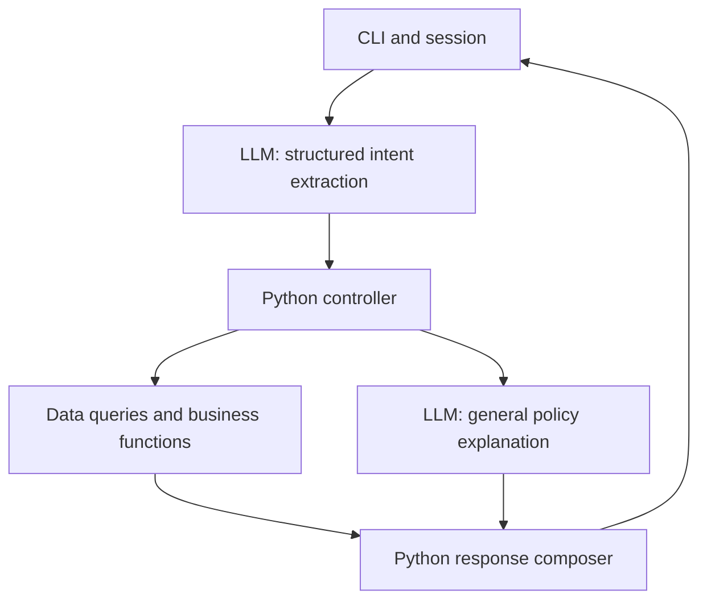

# Architecture and Scope

Status: planning baseline, recorded on 2026-11-02. The CSV loader, typed contracts, and provider extraction boundary are implemented; catalog search and nonstacking pricing are also implemented in `catalog.py`; an offline catalog controller, deterministic composer, and command-based fake-provider CLI are implemented for issue #10. Local Ollama extraction with qwen2.5:3b is implemented for P08, session-scoped order lookup for P09, and a minimal general-policy/service-message slice for P12; return, installment, and freight assessments are planned. See README for search, rounding, and result-limit conventions. This document records the user's architectural direction; implemented contract defaults and remaining work are distinguished in CONTRACT.md. P03 below records conservative policy decisions for subsequent implementation and review.

## Objective and requirements

Build a simple Python text assistant that serves Empório da Música customers and reduces repetitive work for the store team. It must use a suitable persona, ground answers in supplied data, distinguish operational questions from policy questions, and handle requests outside the store's scope.

The assignment permits a CLI, any model/provider, selective use of the supplied data, and optional history persistence. Deliver a public GitHub repository with incremental commits, reproducible instructions, justified technical decisions, limitations, AI-assistance disclosure, and three to five actual conversation examples including a nontrivial lookup or policy application. Submit by the email deadline and make no repository changes afterward. The deadline is not yet recorded.

## Architecture

| Component | Responsibility |
| --- | --- |
| CLI | Read messages, retain session state, display responses. |
| LLM | Extract intents/entities; explain general policies using the manual. |
| Controller | Validate proposals, resolve references, collect missing facts, enforce access, execute allowed operations sequentially. |
| Python functions | Query data and compute availability, prices, payment conditions, freight, and policy assessments. |
| Composer | Render critical results directly using stable templates; include general policy prose as a separate block. |

Use one agent, CSVs loaded into memory, Pydantic contracts, session-only history, and pytest for deterministic behavior. Keep model interpretation evaluations separate. No SQLite, orchestration framework, vector database, concurrent execution, or persistent chat store initially. The initial provider/model is local Ollama with configurable qwen2.5:3b, selected by the user. The small-model interpretation limitations and live verification are recorded in OLLAMA_EVALUATION.md. Provider-neutral interfaces and extraction validation live in `providers/base.py` and `providers/extraction.py`; the offline adapter is isolated in `providers/demo.py`. The official extraction prompt is `providers/prompts/extraction.md`, loaded after the full manual context. It classifies general policy questions without emitting free-form answers. General explanations use a separate call with `providers/prompts/policy.md` (P12 minimal slice), validated in `providers/policy.py`. The CLI constructs adapters and owns terminal interaction, while the controller imports only the neutral interface and extraction function. Package initializers do not load concrete adapters or the CSV loader.

Expose a closed set of operations to the controller. The model must not generate executable code, arbitrary SQL, or arbitrary function names. Multiple intents execute sequentially; dependencies must be resolved before dependent execution. A missing product selection blocks its payment calculation, not an independent hours question.

There is no free-form synthesis after each query. Python composes prices, discounts, stock, order information, failures, and clarification questions. A separate LLM call for general policy explanations is a proposed implementation detail, invoked only for that route. It must not decide individual eligibility or make commercial commitments.

## Data and source audit

The six supplied CSVs contain 9 categories, 65 products, 50 customers, 20 orders, 22 order items, and 25 promotions. The manual has eight pages, version 2.1, June 2025. See [CONTEXT.md](../CONTEXT.md#dataset-findings) for paths, schema, counts, checks, and individual findings.

The P04 loader uses standard-library CSV parsing in `data/loader.py` and typed dataclass records in `data/records.py`; Pydantic intent/result contracts are implemented separately in `contracts/`. It accepts an explicit source directory and returns all six tables with in-memory indexes only after validation succeeds. Original files remain external and unchanged. A derived demonstration snapshot in `data/demo/` replaces customer details, order notes, and tracking codes with synthetic values; it is the default for the validation command. Tests cover small synthetic fixtures and the bundled demonstration. See README for supported normalization and invocation.

Preserve source data and distinguish it from normalized application records. Validate IDs, relationships, numeric values, dates, product specifications, and nullable order fields when loading. Use decimal arithmetic or integer cents for money. Fail clearly on invalid required data; do not silently invent replacements.

Important cases include discontinued and coming-soon products with positive stock, an active product with zero stock, categories without products, promotions without validity dates, and historical order totals that differ from current catalog totals. Do not recompute past payments. The files are snapshots, not live inventory or carrier connections.

## Rules and source precedence

Operational records supply current snapshot facts. The manual supplies policy text. Reviewed configuration supplies executable policy constants with manual section references. The prompt explains behavior, not an independently maintained copy of calculations. Log and document changes when policy text and executable rules change.

Implement these clear rules first:

- A saleable product is active with enough stock for the requested quantity (documented implementation assumption).
- Only active promotions apply. PIX adds no further discount to promotional prices. Show list price, promotion percentage, and final price.
- Recorded order totals remain authoritative for historical orders.
- Estimated delivery is not actual receipt. Unknown receipt date or purchase channel remains unknown.
- Assessment never means cancellation, refund, reservation, or complaint routing has occurred.

### Policy decisions for implementation (P03 / issue #4)

Recorded on 2026-11-02. These are prototype implementation decisions, not changes to store policy or claims of implemented functionality. References below were checked against the text of all eight pages of the supplied `políticas_da_loja.pdf`, version 2.1, June 2025, on 2026-11-02. The original remains outside the repository. The manual confirms the ambiguities recorded in the [source audit](../CONTEXT.md#store-policies-and-unresolved-ambiguities); the choices below distinguish explicit rules from prototype assumptions. This verifies the supplied source, not its legal correctness.

| Case and source | Chosen behavior | Rationale and limitation |
| --- | --- | --- |
| Credit installment summary versus detailed bands (§§3, 3.1) | Prefer §3.1 for explicit requests of 4–6 installments (BRL 80 minimum each) and 7–12 (BRL 100 minimum each). Requests for 2–3 installments require confirmation because the BRL 50 exception is unclear. Do not infer a minimum for that band. | The detailed section is more specific than the general BRL 100 summary. This is a documented interpretation; the original wording confirms the conflicting summary and detailed bands. A general answer must not promise every purchase can use 12 installments. |
| Combined payment (§3) | Recognize the request and return `requires_confirmation`; do not calculate a split or commit payment terms. | The manual allows combinations above BRL 2,000, but allocation and discount interaction are not defined. The threshold alone does not establish a supported quote. |
| Freight exactly BRL 500 (§5) | Return `requires_confirmation` for an otherwise eligible local quote at exactly BRL 500. | Neither the above nor below rule covers equality; do not silently choose free freight or BRL 35. |
| Local delivery region (§5) | Initially support only a customer-declared destination city of Campo Grande/MS. Other cities require confirmation of region eligibility. Ask for destination when absent; do not substitute a customer's recorded city for the delivery address. | Including the store's own city is an explicit prototype assumption. No metropolitan municipality list or postal-code mapping is supplied. Normalize case/accents only; do not infer geography from a postal code. |
| Freight subtotal (§§3, 5, 6) | Compare BRL 500 against the sum of supported item totals after applicable discounts, before freight. Require products, quantities, and payment conditions sufficient to calculate that subtotal. | This is an implementation assumption because the manual does not define the comparison basis. Missing basket quantities are not defaulted to one. For the supported city, below BRL 500 costs BRL 35; above is free. |
| External or special freight (§5) | Exact outside-region/carrier quotations are `unavailable`. A city whose region membership is unknown first requires confirmation. | There is no carrier integration, product weight/dimension coverage, or supported quotation capability. Collecting a postal code alone cannot make an exact quote possible. Manual transit ranges may be described as general estimates, never a promised arrival date. |
| Preference-exchange starting event (§4.3) | Individual preference assessments return `requires_confirmation` for the start of the seven-day period, even if purchase and receipt dates are known. | Selecting purchase or receipt would invent a policy. General explanations can state the seven-day wording and the unresolved starting event. Stock and condition remain relevant but cannot resolve this ambiguity. |
| Conflicting phone/email (cover/company table, §7) | Publish neither conflicting phone nor email as the authoritative contact. A contact request returns `requires_confirmation` and explains that the supplied manual conflicts. | No source establishes precedence. Do not invent a channel, claim a transfer, or ask the customer to select the official contact. A reviewed source correction is needed. |
| Simulated customer identity (§9; architecture safeguard) | A future CLI startup option selects a known fixture customer outside the model and conversation. Validate it against loaded records; an unknown supplied identity fails startup. With no identity, catalog/policy routes remain usable but order access is `unauthorized`. Identity stays fixed until a new session. | This demonstrates access scoping, not authentication. A message, email, order number, or model field cannot establish identity. Use reviewed challenge data or synthetic records, minimize exposed fields, and render foreign/nonexistent orders consistently. |

### Clock and calendar

Use the IANA store timezone `America/Campo_Grande`, based on the supplied store location, independently of the developer's timezone. Inject a timezone-aware clock into date-dependent application logic; convert its instant to the store timezone before deriving today's date. Tests provide a fixed instant, including cases on either side of local midnight. Reject naive clock values rather than assigning an implicit timezone. Ensure timezone data is available on every supported platform when this is implemented.

Resolve relative customer dates against that clock only when their meaning is unambiguous. Otherwise ask for an explicit date. Reject future dates asserted as past receipt; an order delivery estimate never establishes receipt. Preserve customer-declared dates separately from verified records. For a known starting date, use calendar-date differences, with elapsed day zero on that date and the stated last day included. This day-count convention is a prototype assumption, not legal advice; it does not resolve the missing start event for preference exchanges.

Regular hours remain Monday–Friday 09:00–18:00 and Saturday 09:00–13:00, closed Sundays/holidays (§2). No holiday calendar, special hours, dispatch calendar, or business-hour counting convention is supplied. State regular hours and any manual business-day ranges with their limitations; do not calculate exact reopening, arrival, refund, or complaint-response deadlines. The current date alone cannot prove the store is open.

### Supported operation boundary

This table defines the implementation scope for later issues; no runtime operations are available in P03. Use the statuses defined in [CONTRACT.md](CONTRACT.md#operation-results).

| Classification | Cases |
| --- | --- |
| Supported once implemented | Snapshot catalog queries, active/stock availability, nonstacking promotion/PIX calculations, historical order lookup scoped to the simulated session, supported installment bands and Campo Grande freight, and general explanations grounded in the manual. Withdrawal/defect assessments use relevant known or explicitly declared facts and assess conditions only. |
| `needs_information` | Missing or ambiguous product/order selection, destination, basket quantity, payment conditions, purchase channel, actual receipt, or relevant product-condition facts. Ask only for facts needed by the pending operation. |
| `requires_confirmation` | Ambiguous installment band, combined payment, exact BRL 500 local freight, unknown metropolitan eligibility, preference-exchange start event, conflicting contacts, or another policy judgment reserved for management (§10). State the need for confirmation without claiming it was requested from a person. |
| `unavailable` | Exact external freight, live inventory/carrier updates, payment execution, refund, cancellation, reservation, complaint registration, human transfer, and production authentication. Acknowledging or assessing a request does not perform it. |
| `unauthorized` | Order access without an established simulated identity. For an established identity, foreign and nonexistent order references share a nonrevealing external response. |

Missing manufacturer-specific warranty periods remain unknown (§8); refer to the product certificate without inventing coverage. Active promotion flags govern the snapshot (§6), not today's month. Promotions do not imply final-sale exclusions (§4.4). Negative availability or assessment is a successful business result, not a technical failure. Errors must not produce fallback prices or invented policy facts.

The manual's legal statements were not independently reviewed. Treat them as supplied challenge material, not as verified legal guidance. Section 10 provides for management confirmation when policy application is uncertain.

## Conversation and safeguards

Use a welcoming, informal but professional persona. The store sells instruments, not accessories; redirect politely without inventing partner stores. Ground operational assertions in successful queries.

Keep three or four short few-shot examples illustrating nonstacking discounts, missing return facts, discontinued stock, and accessory requests. Examples demonstrate behavior and must not become current price data. Use different cases for evaluation.

Pair explicit prohibitions with an actionable fallback. Enforce important restrictions in code; prompt wording is not a guarantee. Customer messages and free-text data fields cannot change system instructions or session authorization.

For a simple order demonstration, use an explicitly simulated customer identity selected outside model output. This is not production authentication. Restrict order lookup in code and return only necessary fields. Avoid customer data in routine logs and do not transmit entire customer tables to the provider. Do not publish real personal data; use reviewed challenge fixtures or synthetic test data.

Track operations, result states, and policy references for diagnosis. Long model-generated reasoning is neither required nor evidence that a decision is correct. Do not claim a complaint, transfer, refund, or cancellation succeeded without a corresponding executed capability.

## Validation and scope control

Unit tests cover rules, boundaries, data normalization, and response formatting. Controller tests cover access, missing information, references, dependencies, malformed model output, and failures using a fake provider. Live-model evaluations cover intent/entity extraction, grounding, out-of-scope requests, and conversation continuity. Core CI must run without paid API credentials.

Keep production authentication, WhatsApp integration, live carriers, payment processing, persistent complaints, deployment, and vector retrieval outside the initial scope. Unsupported requests receive an honest limitation and next step. No promise of improved hiring outcomes is implied; prioritize a working, understandable, demonstrable submission.

See [the contract](CONTRACT.md) for interfaces and [the GitHub plan](GITHUB_PLAN.md) for implementation order.
